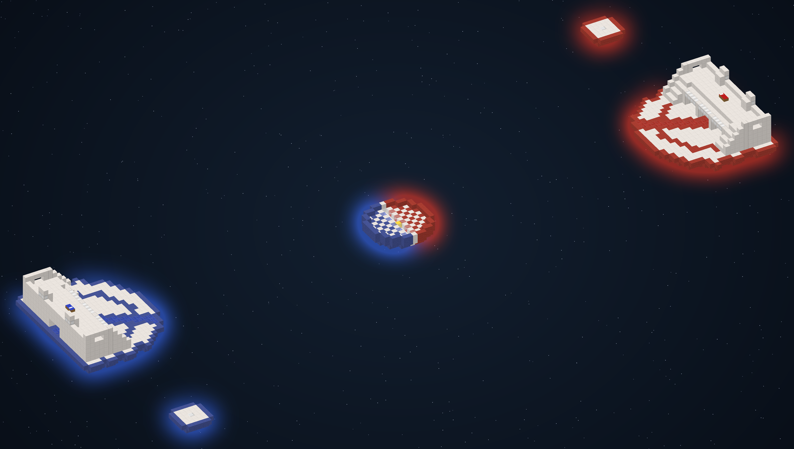

<div align="center">

<h1>BedWars on Pumpkin</h1>

<p>BedWars with Minecraft 1.8 PvP on <a href="https://pumpkinmc.org">Pumpkin</a>, a Minecraft server written in Rust</p>

[](https://github.com/alexander-zierhut/pumpkin-mc-bedwars/actions/workflows/build.yml)
[](https://www.minecraft.net)
[](https://pumpkinmc.org)
[](https://github.com/alexander-zierhut/pumpkin-mc-pvp)
[](plugin/src)
[](plugin/build.mjs)
[](#start-a-server)
[](LICENSE)



<p>
<a href="#start-a-server">Start a server</a> ·
<a href="#the-story">The story</a> ·
<a href="#features">Features</a> ·
<a href="#playing">Playing</a> ·
<a href="#changes-to-pumpkin">Changes to Pumpkin</a> ·
<a href="#development">Development</a> ·
<a href="#contact">Contact</a>
</p>

</div>

## Start a server

You need [Docker](https://docs.docker.com/get-docker/). One command downloads and starts the server:

```bash
docker run -dit --name bedwars --restart unless-stopped -p 25565:25565 -v bedwars:/srv ghcr.io/alexander-zierhut/pumpkin-mc-bedwars:latest
```

Then join on the address of that machine and make yourself admin in the console:

```bash
docker attach bedwars        # type: op <your Minecraft name>, leave with Ctrl+P Ctrl+Q
```

> [!NOTE]
> Players join with a normal Minecraft Java 26.3 client. The 1.8 combat is done by the server, so nobody needs an old
> client, ViaVersion or a mod.

<details>
<summary>Updating, and running without Docker</summary>

Update with `docker pull ghcr.io/alexander-zierhut/pumpkin-mc-bedwars:latest`, then remove and start the container
again with the same command. Worlds, settings and statistics stay in the volume `bedwars`.

Without Docker (Linux x86_64): download `bedwars-server-linux-x86_64.tar.gz` from the
[latest release](https://github.com/alexander-zierhut/pumpkin-mc-bedwars/releases/tag/latest), unpack it and run
`./start.sh`.

</details>

## The story

This started as a LAN party server on Paper. Out of curiosity it was ported to Pumpkin, and Pumpkin's performance was
the reason to keep going. It was also already close to running a PvP minigame like this. What was left were mostly
details in combat, projectiles and inventories, and a few additions to the plugin API.

Those pieces are in a [fork of Pumpkin](https://github.com/alexander-zierhut/pumpkin-mc-pvp), and each of them is
also a separate pull request in that fork, so the Pumpkin maintainers can look at them one by one and take what fits.
The game itself is a TypeScript plugin that runs in Pumpkin's WebAssembly plugin host.

## Features

<table>
<tr>
<td width="50%" valign="top">
<h4>1.8 combat for modern clients</h4>
No attack cooldown, sword blocking, 1.8 damage, criticals and knockback, all done by the server. Optional with
<code>[pvp.legacy_combat]</code>.
</td>
<td width="50%" valign="top">
<h4>The 1.8 bow</h4>
Compared with a real 1.8.9 server over 128 identical shots: the same launch speed and spread, and the flight follows
the 1.8 path to within 0.05 blocks (<a href="reports/bow-1.8.9-vs-pumpkin.md">report</a>).
</td>
</tr>
<tr>
<td valign="top">
<h4>Small footprint</h4>
A lobby with 8 players uses about 2 % of one CPU core and about 240 MB of RAM, a running 1v1 round about 4 %. The
server starts in a few seconds.
</td>
<td valign="top">
<h4>TypeScript plugin</h4>
Lobby, teams, shop, resource spawners, special items, rejoin and statistics in about 3,700 lines of TypeScript,
compiled to a WebAssembly component.
</td>
</tr>
<tr>
<td valign="top">
<h4>Tested by bots</h4>
18 end-to-end specs with about 500 checks: mineflayer bots join, buy, bridge, fight, shoot and break beds on throwaway
servers.
</td>
<td valign="top">
<h4>One command</h4>
<code>docker run</code> to play, <code>./bedwars.sh</code> to build everything from source. Only Docker and git are
needed.
</td>
</tr>
</table>

## Playing

Two teams, Red and Blue. Everyone who joins lands in the lobby of the active map and picks a team with the item in
the hotbar. An admin starts the round with the diamond in the lobby or with `/start`. Break the enemy bed, then the
last team standing wins.

- Spawners drop Bronze, Iron and Gold. The villagers are the shop: blocks, weapons, armor, bows, potions, specials.
- Specials: Teleporter, Parachute, Mobile Shop, Rescue Platform, TNT, Ender Pearl, Team Chest.
- Rush is the map that comes with the server. More maps can be added, see below.

<details>
<summary>Commands</summary>

| Command | Who | What |
|---|---|---|
| diamond item in the lobby, `/start` | admin | start the round |
| `/map [name]` | admin | show or change the active map |
| `/setteam <player> <team>` | admin | put a player into a team before the start |
| `/bwconfig countdown/min-players/game-time/grace-seconds <value>` | admin | change settings while the server runs |
| `/bw join`, `/bw leave`, `/bw list`, `/bw stats [player]`, `/bw help` | everyone | |
| `/autojoin` | everyone | stop or start joining rounds automatically (to build or watch) |

</details>

<details>
<summary>Settings</summary>

The server folder is the volume (`/srv` in the container, `docker volume inspect bedwars` shows where it is):

| File | What |
|---|---|
| `pumpkin.toml` | ports, MOTD, view distance, `online_mode`, `[pvp.legacy_combat]` (1.8 combat on or off), RCON |
| `plugins/data/lan-bedwars/` | arenas you added, statistics (`stats.yml`), the active map |

`online_mode = true` checks every player against the Mojang login servers, so the server needs internet. For a LAN
without internet set it to `false` (in the `[networking.java]` section). The RCON password is generated on the first
start and written into `pumpkin.toml`; RCON is only reachable from the machine itself unless you publish port 25575.

</details>

<details>
<summary>Adding maps</summary>

Only Rush is included. To add a map:

1. Copy the world folder to `bedwars/<world name>/` in the server folder.
2. Write an arena file in the ScreamingBedWars format (see [config/arena-rush.yml](config/arena-rush.yml) and
   [config/arena-mushroom.yml](config/arena-mushroom.yml)) with `world: <world name>` and put it into
   `plugins/data/lan-bedwars/arenas/`.
3. Restart the server and switch with `/map <name>`.

</details>

## Changes to Pumpkin

A BedWars round touches many parts of a server, so the port turned up a number of small things. The fork's
[pull requests](https://github.com/alexander-zierhut/pumpkin-mc-pvp/pulls) are against Pumpkin's `master`, each
with a short description, the vanilla code it follows and how it was tested. Notes on every finding are in
[PUMPKIN-FINDINGS.md](PUMPKIN-FINDINGS.md).

| Area | Examples |
|---|---|
| Combat | optional 1.8 combat, knockback from the server's own motion, motion syncs like vanilla |
| Projectiles | players as projectile targets, the vanilla arrow flight order, shooter movement, owner and vehicle rules |
| Inventory | component hashes like vanilla, stack comparison, styled item names, screens that keep the cursor |
| Network | moves during a teleport, teleport ids, the chunk view after a teleport, the join order |
| Plugin API | item drops, filtered explosions, shared GUIs, forced chunks, explode events with their source |
| Performance | fewer Rayon wake-ups for small worlds, Fx hashing for chunk maps, non-blocking plugin events |

## Development

Clone with the fork as a submodule and start everything with one command. The Rust and Node builds run in
containers:

```bash
git clone --recurse-submodules https://github.com/alexander-zierhut/pumpkin-mc-bedwars.git
cd pumpkin-mc-bedwars
./bedwars.sh
```

The first build compiles Pumpkin (about 10 to 20 minutes), later builds reuse the cache. The server runs on port
25565 with its folder in `./data`. [DEVELOPMENT.md](DEVELOPMENT.md) has the state of the project, the rules it
follows and how the fork branches are maintained.

| Command | What |
|---|---|
| `./bedwars.sh` | build the fork and the plugin, start the server |
| `./bedwars.sh plugin` | rebuild only the TypeScript plugin and restart (seconds) |
| `./bedwars.sh logs` / `console` / `stop` | log, console, stop |
| `./bedwars.sh reset-maps` | put the pristine maps back |
| `./bedwars.sh test [spec]` | the bot test suite, needs Node 22 or newer (about 35 minutes, or one spec by name) |

`BEDWARS_PORT=25566 ./bedwars.sh` runs a second server next to one on 25565.

<details>
<summary>Project layout</summary>

| Part | Where |
|---|---|
| Pumpkin fork (submodule, branch `bedwars-pvp-fixes`) | `vendor/Pumpkin` |
| The game (TypeScript, platform independent) and its Pumpkin adapter | `plugin/src`, `plugin/src/pumpkin-platform.ts` |
| Plugin build: esbuild and componentize-qjs (QuickJS) to a WebAssembly component | `plugin/build.mjs` |
| Game settings, shop and arenas (built into the plugin) | `config/` |
| Server image and start scripts | `Dockerfile`, `docker/`, `bedwars.sh` |
| Bot tests (mineflayer through ViaProxy) and the 1.8.9 comparison | `tests/` |
| Fork branch and PR tooling | `tools/fork/` |

</details>

<details>
<summary>Test specs</summary>

| Spec | Checks |
|---|---|
| 00 smoke, 01 to 03 maps | server starts, every map loads and plays (02 and 03 are skipped without the extra maps) |
| 10 lobby | auto-join, team selector, countdown, /map, /autojoin, late joiners, void |
| 20 economy | spawner rates and stacks, names, holograms, pickup, despawn |
| 30 shop | every item of shop.yml, prices, shift-click, number keys, team colours |
| 40 / 41 bow | 1.8 bow launch and flight; control run without legacy combat |
| 50 melee | 1.8 damage table, crits, hit delay, knockback, blocking, armour, regeneration |
| 60 special items | Teleporter, Parachute, Mobile Shop, Rescue Platform, TNT, Ender Pearl, Team Chest |
| 70 full game | a whole round with three players |
| 80 lobby load | 8 players at once, leave and rejoin churn |
| 90 rejoin | reconnect into the team, grace period |
| 95 to 98 | play test fixes, void protection, admin start, network sync |

Each spec starts its own throwaway server in Docker with ViaProxy in front (mineflayer speaks 26.1). The plugin's unit
tests run with `cd plugin && npm test`.

</details>

## How this was made

Most of the code here and in the fork was written with an AI coding agent (Claude Code) over about a week. Each change
was checked against the decompiled vanilla 26.3 server, the combat against a real 1.8.9 server, and everything with
the bot test suite and play tests with real clients.

## License

This repository (plugin, tests, tools, the Rush map) is under the [Apache License 2.0](LICENSE). The server binary
in the image and the release is built from the [Pumpkin fork](https://github.com/alexander-zierhut/pumpkin-mc-pvp),
which is GPL-3.0 like Pumpkin; both licenses are included.

## Contact

If you would like to run it, add maps, help with the upstream pull requests or work together on something similar,
you can reach me on Discord: `alzlper`.
